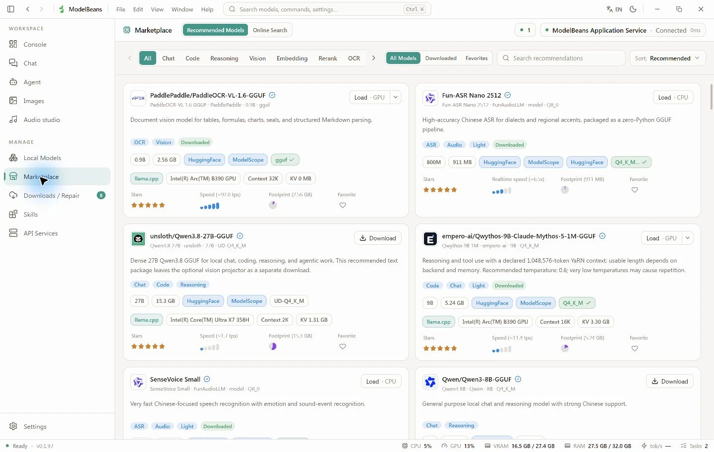

# ModelBeans

**Run AI on your PC. Connect it to your tools.**

[简体中文](README.zh-CN.md) · [Getting started](docs/getting-started.md) · [Embed in your app](docs/embedding.md) · [Report an issue](https://github.com/modelbeans/modelbeans-releases/issues)

ModelBeans is a personal project I work on in my spare time, with help from GPT and Claude.

I started because running models on my own computer felt far too complicated and fragmented: downloading and managing models, setting up different inference engines, checking operating system and hardware requirements, understanding resource use and performance, and connecting agent tools. Every step could mean more research, configuration, and trial and error.

I want ModelBeans to bring these steps together in one platform and take care of as much of the setup and management as possible. That leaves you more time to use local models to get things done, explore ideas, or build and share your own applications. Making that whole journey easier is the direction I’m working toward.

ModelBeans also includes a built-in agent. I’ll keep improving it alongside the local model platform, gradually turning model management, multiple inference backends, resource awareness, and performance evaluation into practical advantages for getting tasks done. My hope is for it to become better at making use of the models and resources on your computer, and grow into a useful agent with a character of its own.

> **ModelBeans 0.1.97 · Windows x64 public preview.** [Downloads and release notes](https://github.com/modelbeans/modelbeans-releases/releases/tag/v0.1.97-rc.1) · [Compatibility and known limitations](docs/compatibility.md). RuntimeShare is included; models are downloaded separately. Product implementation source is not published at this stage.

## Operating systems and hardware

ModelBeans is developed and tested on Windows PCs with Intel and AMD integrated graphics. These are the platforms supported for the initial release—you do not need a discrete graphics card to get started.

| Operating system and hardware | Current status |
| --- | --- |
| Windows x64 + Intel integrated graphics | Supported; used for day-to-day development and testing |
| Windows x64 + AMD integrated graphics | Supported; used for day-to-day development and testing |
| Linux | Linux code is already in place; a release will follow validation on Linux hardware |
| Discrete GPUs | Planned; support will be added after we obtain suitable hardware for integration and testing |

Available inference backends and models still depend on the GPU model, drivers, model format, and available memory. Platform support does not mean every backend supports both hardware families.

[Browse the illustrated introduction](https://modelbeans.github.io/modelbeans-releases/site/index.en.html) · [中文图文介绍](https://modelbeans.github.io/modelbeans-releases/site/index.html)

## What can you do with it?

### Find models in two marketplaces

Browse and download models through the built-in Hugging Face and ModelScope marketplaces, or import models you already have.

Two sources give you more options for downloading. Model revisions, available files, and access requirements can still differ between sources.

### Manage different kinds of models in one place

Text chat, image understanding, embeddings, speech recognition, and image generation belong in the same toolbox.

RuntimeShare brings together multiple inference backends. The project's integration scope includes llama.cpp, OpenVINO, ONNX Runtime, stable-diffusion.cpp, audio.cpp, and Strata; release notes will identify which backends actually ship in each package. The aim is to handle more of the framework setup for you, so you can focus on what you want to run.

**Upstream support does not mean every model has been tested in ModelBeans.** Formats, adapter versions, drivers, and hardware all matter. My testing time and equipment are limited, so reports of both working models and failed attempts are welcome.

### Connect local models to your tools

ModelBeans offers an OpenAI-style API and partial compatibility with Ollama and Anthropic APIs, along with configurable ports, model roles, and aliases. For example, you can configure a `code` alias so a client keeps the same model name while you change the local model behind it.

A dedicated connection panel brings together Claude Code, Codex CLI, OpenCode, WorkBuddy, DeepSeek Harness, and Marvis. For supported clients, it helps select and load a model, check context capacity, and configure the connection. Marvis requires manually saving the generated connection details. A successful connection is only the beginning: reliable tool use, instruction following, and longer tasks also depend on the model.

### Try image and audio workflows

Generate images with compatible models, or explore speech generation, voice cloning, song covers, music generation and sound design. These experimental workflows demonstrate how different models can work together on one local platform; capabilities and quality depend on the models you choose.

### Use the built-in agent

The agent shares the platform’s model selection and loading workflow, so there is no separate agent client to install. Choose a local model or configure a cloud model, select a workspace, and grant the tools your task needs. Follow tool calls, review file changes, and intervene or stop when needed.

Both local and cloud models have useful roles. More advanced smart routing is still in development and is not promised as a working feature of the current preview.

### Test before you commit to a model

Built-in lightweight performance and agent-readiness checks help you see how a model behaves on your machine and whether it is a useful candidate for tools that need function calling.

These checks inform your choice; they do not guarantee success on every real task. A fuller BeansEval evaluation application is planned as a separate release.

### Give your own application local inference

Bundle the ModelBeans service and RuntimeShare with your application, start a private child service, call it over local HTTP, and shut down the processes your application owns.

The ModelBeans desktop window does not need to stay open. Here, embedding means an application-managed child service, rather than linking an inference engine into your process. There are [Python and Node.js examples](examples/README.md) with no third-party package dependencies.

## Where do I start?

To get started:

1. Download a package for your system from [Releases](https://github.com/modelbeans/modelbeans-releases/releases), and check its hardware and backend notes.
2. Download a small model that fits your machine, or import one you already have.
3. Load the model and try a short conversation.
4. To connect another tool, enable the API service and copy its address, API key, and model identifier.

The default local service address is `http://127.0.0.1:10723`. OpenAI-style clients generally use `http://127.0.0.1:10723/v1`. Use the port actually shown in the application.

| What you want to do | Start here |
| --- | --- |
| Download, load, and use your first model | [Getting started](docs/getting-started.md) |
| Call a local model from a script or coding tool | [API setup and example](docs/getting-started.md#call-the-local-api) |
| Add local inference to your own application | [Embedding guide](docs/embedding.md) |
| See complete startup, inference, and shutdown code | [Python / Node.js examples](examples/README.md) |

## Local models, cloud models, and privacy

With local inference selected, the model runs on your device. Downloads, network-enabled tools, and cloud services you configure can still access the network. Local AI does not mean every feature is offline. When using the agent, check your selected model, workspace, tool permissions, and cloud data permissions.

## Help make it nicer to use

If a model fails to load, a button is confusing, or the instructions leave you stuck, please [open an issue](https://github.com/modelbeans/modelbeans-releases/issues). Working model reports, tools you would like to connect, and feature ideas are useful too.

For bug reports, include the application version, operating system and hardware, model name, backend, steps to reproduce, and redacted logs. Please keep API keys and private files out of reports.

Thank you to the communities building the inference engines, models, tools, and libraries behind this project. Much of what ModelBeans can offer comes from your work.

## Licensing and redistribution

Distribution is currently binary-only. RuntimeShare binaries use the standard Apache-2.0 license, permitting commercial use, embedding, and redistribution under its terms; implementation source is not included. ModelBeans and SDK artifacts retain their applicable MIT OR Apache-2.0 licensing. Third-party engines, libraries, and models have separate terms. Keep the licenses and NOTICE files supplied with the package, and refer to the license files for the specific release.
