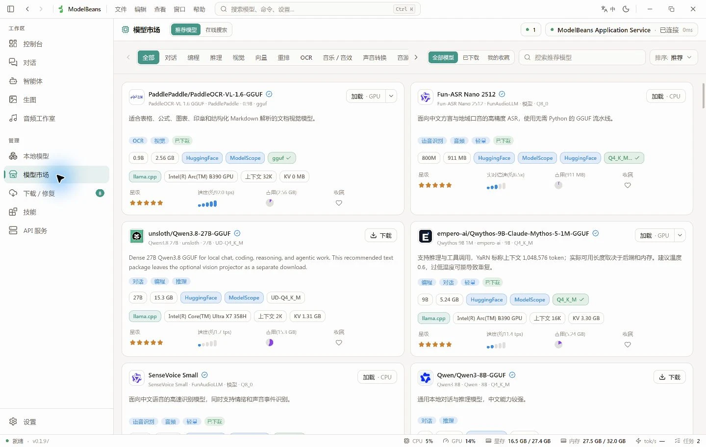

# ModelBeans

[直接下载 ModelBeans 0.1.97](<https://github.com/modelbeans/modelbeans-releases/releases/download/v0.1.97-rc.1/ModelBeans-0.1.97-win-x64.exe>) · [版本说明](https://github.com/modelbeans/modelbeans-releases/releases/tag/v0.1.97-rc.1)
**在自己的电脑上运行 AI，也让常用工具用上它。**

[English](README.md) · [快速上手](docs/getting-started.zh-CN.md) · [嵌入你的应用](docs/embedding.zh-CN.md) · [反馈问题](https://github.com/modelbeans/modelbeans-releases/issues)

ModelBeans 是一个个人业余项目。我和 GPT、Claude 一起，一点点把它做成现在的样子。

做它的出发点，是在自己的电脑上跑大模型实在太复杂、太零散了：下载和管理模型、配置不同的推理框架、确认系统和软硬件是否兼容、了解资源占用和实际性能，再到接入智能体软件，每一步都可能需要查资料、配环境、反复尝试。

我希望把这些环节串起来，放进 ModelBeans 这一个平台里，让它尽可能承担本地模型使用过程中繁琐的准备和管理工作。用户不必把大量时间花在搭环境、调配置和连接工具上，而能专注于用本地模型完成任务、尝试想法，或开发和分享自己的应用。这是我持续完善 ModelBeans 的方向。

ModelBeans 也内置了一个智能体。我会持续打磨它，让它与本地模型平台一起成长，逐步把模型管理、多种推理后端、资源感知和性能评测这些平台能力，转化为完成实际任务的优势。我希望它越来越懂得如何用好用户电脑上的模型和资源，成长为一个有自己特色、能帮上忙的智能体。

> **ModelBeans 0.1.97 · Windows x64 公开预览版。** [直接下载 ModelBeans 0.1.97](https://github.com/modelbeans/modelbeans-releases/releases/download/v0.1.97-rc.1/ModelBeans-0.1.97-win-x64.exe) · [版本说明](https://github.com/modelbeans/modelbeans-releases/releases/tag/v0.1.97-rc.1) · [兼容范围与已知限制](docs/compatibility.zh-CN.md)。完整安装包包含 RuntimeShare，模型另行下载。现阶段不公开产品实现源码。

## 操作系统与硬件支持

ModelBeans 是在 Intel 和 AMD 集成显卡的 Windows 电脑上开发和测试的。这也是当前首发支持的平台，使用它不需要先配一张独立显卡。

| 系统与硬件 | 当前状态 |
| --- | --- |
| Windows x64 + Intel 集成显卡 | 当前支持，日常开发与测试平台 |
| Windows x64 + AMD 集成显卡 | 当前支持，日常开发与测试平台 |
| Linux | 已有相关代码，完成 Linux 实机验证后推出版本 |
| 独立显卡 | 后续计划；取得相应硬件后，再进行适配和验证并添加支持 |

具体可用的推理后端和模型仍取决于显卡型号、驱动、模型格式与可用内存；平台支持不代表每个后端都支持这两类硬件。

[查看图文介绍](https://modelbeans.github.io/modelbeans-releases/site/index.html) · [English introduction](https://modelbeans.github.io/modelbeans-releases/site/index.en.html)

## 可以用它做什么？

### 从两个模型市场开始

内置 Hugging Face 和魔搭 ModelScope 模型市场，支持从两个来源寻找和下载模型。也可以导入已有的本地模型，让下载好的文件继续派上用场。

双源提供更多下载选择；不同来源的模型版本、文件和访问条件仍可能不同。

### 在一个地方管理不同类型的模型

从文本对话、看图问答，到文本嵌入、语音识别和图片生成，ModelBeans 希望把这些能力放到统一的使用入口里。

底层由 RuntimeShare 集成多种推理后端。项目的集成范围包括 llama.cpp、OpenVINO、ONNX Runtime、stable-diffusion.cpp、audio.cpp 和 Strata；首发实际随包提供哪些后端，请看发行说明。尽可能由软件处理框架衔接，让你把注意力放在模型和用途上。

**上游框架支持，不等于任意模型都已经在 ModelBeans 中验证。** 模型格式、适配版本、驱动和硬件都会影响结果。我的设备和时间有限，很欢迎大家分享成功运行的模型，也欢迎提交失败案例。

### 让本地模型接入你常用的工具

提供 OpenAI 风格接口，以及 Ollama、Anthropic 的部分兼容接口；支持模型角色、模型别名和服务端口配置。例如，让客户端一直请求你设置的 `code` 别名，再由 ModelBeans 映射到当前使用的本地模型。

集中连接面板覆盖 Claude Code、Codex CLI、OpenCode、WorkBuddy、DeepSeek Harness 和 Marvis，帮助选择和加载模型、检查上下文容量，并为支持的客户端自动配置连接。Marvis 需手动保存生成的接入信息。API 接通只是第一步：模型是否能可靠调用工具、遵循指令、完成较长任务，还需要实际测试。

### 试试图片和音频工作流

使用兼容模型生成图片，或尝试语音生成、语音克隆、K 歌合成、音乐生成和声音设计。这些实验性工作流展示了在一个本地平台上组合不同模型的用法；具体能力与效果取决于所选模型。

### 直接使用内置智能体

内置智能体与平台的模型选择、加载流程相连，不必再安装另一套智能体客户端。选择本地模型或配置云端模型，设置工作目录与工具权限，即可尝试处理任务；过程中可以查看工具调用与文件变更，随时介入或停止。

本地和云端都有各自适合的用途。更复杂的智能路由仍在开发中，不作为当前预览版已经可用的承诺。

### 先测一测，再决定怎么用

内置轻量性能评测和智能体就绪评测，帮助你了解模型在自己电脑上的表现，以及它是否适合接入需要工具调用的应用。

这些结果是选模型的参考，不代表模型能完成所有真实任务。更完整的 BeansEval 评测工具计划后续单独发布。

### 把推理服务放进自己的程序

你也可以把 ModelBeans 服务和 RuntimeShare 作为应用随附的独立进程使用：由你的程序启动服务，通过本地 HTTP 调用模型，退出时回收自己启动的进程。

不需要让用户一直开着 ModelBeans 桌面窗口。这里的“嵌入”指随应用管理的子进程服务，不是把推理引擎直接链接进应用进程。已经准备了不依赖第三方包的 [Python 和 Node.js 示例](examples/README.md)。

## 从哪里开始？

开始使用：

1. 从 [直接下载](https://github.com/modelbeans/modelbeans-releases/releases/download/v0.1.97-rc.1/ModelBeans-0.1.97-win-x64.exe) 安装包，并查看[版本兼容说明](https://github.com/modelbeans/modelbeans-releases/releases/tag/v0.1.97-rc.1)。
2. 从模型市场下载一个适合本机内存的小模型，或导入已有模型。
3. 加载模型，先完成一次简单对话。
4. 需要接入其他工具时，启用 API 服务，复制服务地址、密钥和模型标识。

默认本机服务地址为 `http://127.0.0.1:10723`；OpenAI 风格客户端通常填写 `http://127.0.0.1:10723/v1`。以软件实际显示的端口为准。

| 你想做什么 | 从这里开始 |
| --- | --- |
| 下载、加载并使用第一个模型 | [快速上手](docs/getting-started.zh-CN.md) |
| 用脚本或编程助手调用本地模型 | [API 配置与调用示例](docs/getting-started.zh-CN.md#调用本地-api) |
| 给自己的程序加上本地推理 | [嵌入服务指南](docs/embedding.zh-CN.md) |
| 看完整的启动、推理、退出代码 | [Python / Node.js 示例](examples/README.md) |

## 关于本地、云端和隐私

选择本地推理时，模型在你的设备上运行。模型下载、联网工具以及你配置的云端服务仍可能访问网络；“本地 AI”不意味着软件所有功能都离线。使用智能体时，请留意所选模型、工作目录、工具权限和云端数据授权。

## 欢迎一起把它变得更好用

它还不完美。如果你遇到“模型加载失败”“这个按钮看不懂”“文档照着做还是不通”，都欢迎 [提一个 Issue](https://github.com/modelbeans/modelbeans-releases/issues)。成功跑通的模型、想接入的工具和功能建议，也很有帮助。

反馈问题时，附上软件版本、系统和硬件、模型名称、所用后端、复现步骤与脱敏日志，会更容易定位。请不要上传 API Key 或私人文件。

感谢提供底层推理引擎、模型、工具和库的开源社区。ModelBeans 的很多可能性，都建立在你们的工作上。

## 许可与再分发

当前采用二进制发布方式。RuntimeShare 二进制采用标准 Apache-2.0 许可，允许遵照许可商用、嵌入与再分发，实现源码不随包提供。ModelBeans 与 SDK 产物适用其 MIT OR Apache-2.0 许可。第三方引擎、库和模型各自遵循原许可；请保留发行包附带的许可证与 NOTICE。具体以对应发行包的许可文件为准。
